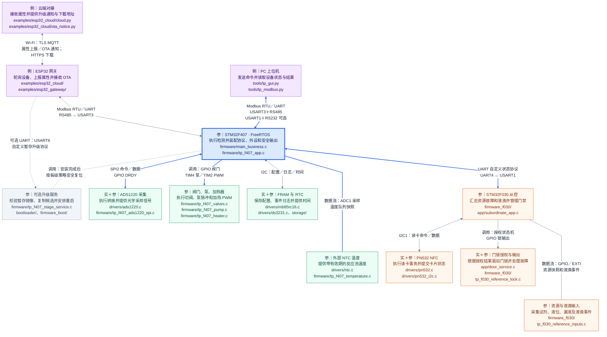
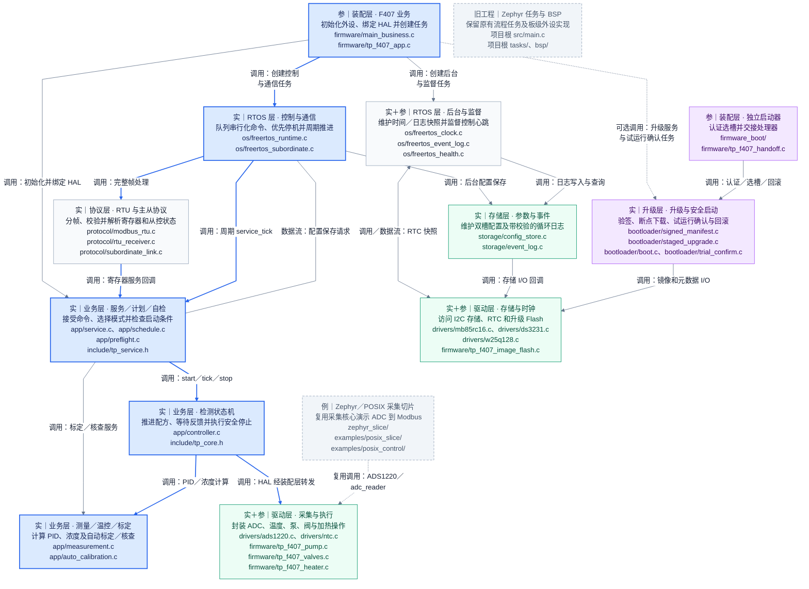

---
cssclasses:
  - water-quality-architecture
---

# 水质检测仪系统框架：整机架构与一次检测

阅读基线：先读 `freertos/README.md`，再依次读 `docs/LEARNING.md`、`COMPONENTS.md`、`STATUS.md`、`MODBUS.md`、`SUBORDINATE.md`，随后沿文档入口核对自有源码。未读取 build*、tests/、third_party/、.git、.vscode 中的内容，未重新编译或运行测试。

以下路径默认相对 `freertos/`；以“项目根”标注的路径相对 项目根目录。

状态标记：**实**＝软件逻辑已有实现，文档报告有主机模拟或测试；**参**＝参考适配或可选装配已有源码，实机待验证；**例**＝教学示例或局部迁移，端到端待联调。它们描述不同验证层次；“实”不表示整机已通过验收。

默认 F407 镜像仅运行心跳。以下检测链路描述选用板级配置后的业务入口；教学配置还要求启用从控，否则配置函数返回错误并安全停机。示例配方、传感器模型及标定系数均不能作为真实仪器参数或精度依据。

## 1. 整机拓扑（完整图）

本图保留 PC、ESP32、云端、F407、升级服务、ADS1220、NTC、执行器、FRAM/RTC、F030、资源输入、PN532、门锁全部 13 个模块。蓝色主控与连线突出 A 检测路径；绿色是主控外设，橙色是从控与门禁，紫色是外部接入。颜色区分职责，验证状态仍以“实／参／例”为准。

[打开完整 SVG（可放大）](assets/system-topology.svg) · [打开 PNG](assets/system-topology.png)

F407 是 Modbus 从站；PC 或 ESP32 是主站。同一条 RS485 总线上只能有一个主站。若需同时连接，可选启用 USART1 供 PC 使用、USART3 供 ESP32 使用，并协调共享参数访问。

F407/F030 的 CRC 算法虽采用 CRC-16/Modbus，报文仍是项目自定义协议。从控状态未知、过期或带故障时接入启动自检及运行互锁。可选 GPIO 唤醒线和综合故障状态线作为辅助，液滴和故障细节仍经 UART 传输。PN532 是 F030 侧的可选装配；UID 白名单仅作教学，不构成防复制认证。云示例实现状态上报及可选 OTA 通知，未实现通用云端下发控制。

## 2. 主控分层及工程边界（完整图）

本图将七类职责展开为 14 个模块，保留业务调度、协议、检测内核、驱动、后台存储、升级以及并列工程之间的关系。图中的箭头表示真实调用或数据传递，不代表七层必须按目录顺序执行。蓝色线从业务装配延伸到控制调度、服务、状态机及采集执行驱动。

[打开完整 SVG（可放大）](assets/system-layers.svg) · [打开 PNG](assets/system-layers.png)

| 层／工程边界 | 一句话职责 | 对应目录与入口 |
|---|---|---|
| 业务内核 | 决定模式、自检、配方推进、温控、测量与故障处理 | `app/`＋`include/` |
| RTOS 适配 | 用任务和队列调度业务，并处理后台 I/O 与心跳监督 | `os/` |
| 协议 | 完成 Modbus RTU 分帧、寄存器服务及自定义主从状态解析 | `protocol/` |
| 驱动与板级适配 | 将器件事务与业务 HAL 回调连接到真实外设 | `drivers/`＋`firmware/tp_f407_*.c`；项目根 `bsp/` 属于旧 Zephyr 工程 |
| 固件装配 | 绑定依赖、创建任务，或构建独立启动器 | `firmware/`、`firmware_boot/`；项目根 `tasks/` 属于旧 Zephyr 工程 |
| 存储 | 持久保存配置与事件日志并处理校验／提交 | `storage/` |
| 升级 | 认证镜像、暂存安装、管理试运行确认与回滚 | `bootloader/` |

这不是逐层穿透的固定流水线：装配层负责依赖注入，RTOS 层负责线程和队列，业务通过 HAL 回调访问外设。`app/` 与 `include/` 不直接依赖 FreeRTOS 或 STM32。

必须区分三条代码线：FreeRTOS 主体位于 `freertos/`；项目根 `tasks/`、`bsp/` 使用 Zephyr API；`freertos/zephyr_slice/` 是共享采集核心的局部迁移示例。旧 `tasks/` 不能画成 FreeRTOS 的任务层，旧 `bsp/` 也不是当前 FreeRTOS 驱动的必经路径。`firmware_boot/` 是独立启动器装配，`bootloader/` 是可复用升级核心。

CMake/Ninja 属于构建工具，不参与运行时数据流。`freertos/CMakeLists.txt` 用于主机业务库与检查；`firmware/`、`firmware_f030/`、`firmware_boot/` 分别交叉构建对应固件。

## 3. 动态行为、存储布局和重点路径（第 2、3、4 步）

完整内容移至 [SYSTEM_RUNTIME.md](SYSTEM_RUNTIME.md)，取代本文件原先简略的启动、检测和故障流程，避免两份图示重复。

| 顺序 | 图 | 学习目标 |
|---|---|---|
| 第 2 步 | 2A 检测状态机 | 区分 IDLE、RUNNING、COMPLETE、FAILED 和受控等待 |
| 第 2 步 | 2B 完整检测配方 | 顺着 Modbus／计划、自检、取样、读数、反应、计算、清洗排液复述检测 |
| 第 2 步 | 2C 签名暂存 OTA | 区分暂存校验、复制安装、候选提交与重启 |
| 第 2 步 | 2D 启动元数据状态机 | 理解 READY、TRIAL、确认和回滚 |
| 第 2 步 | 2E 启动和任务创建 | 理解默认心跳、可选业务、初始化失败及自检条件 |
| 第 3 步 | 3A 存储布局 | 区分片内固件槽、外部暂存、业务 FRAM 和升级 FRAM |
| 第 3 步 | 3B 看门狗监督范围 | 区分控制心跳、数据过期和 OTA 健康确认 |
| 第 4 步 | 重点标注与证据表 | 蓝色／粗线突出 A 检测路径；列明待确认项并与 LEARNING 映射核对 |

## 4. 沿着完整框架复述设备行为

**启动：** 默认心跳固件不运行检测。选择业务配置后，`firmware/main_business.c` 进入业务装配，`firmware/tp_f407_app.c` 初始化外设、存储与业务对象，创建控制、通信和后台任务，再启动调度；教学配置由控制循环延后做一次上电自检，启动每次检测前仍重新检查。初始化失败必须安全停机；已创建部分任务也不能继续启动。可选独立启动器先认证并选择镜像，再交接到业务入口。具体分支见续篇图 2E。

**一次检测：** Modbus 命令／周期或每日计划 → 服务层启动检查 → 控制器依次取样、读空白与浊度、加试剂、加热与保温、停热、读反应信号、计算浓度、清洗和排液 → 关闭输出并进入 COMPLETE → 对外发布有效结果。ADS1220 提供光学采样，外部 NTC 提供温度，F030 状态参与自检和运行互锁；这些输入经 RTOS 缓存／队列进入控制逻辑。计算成功仍不等于检测完成，后续清洗或排液故障会使结果失效。具体状态和教学配方见续篇图 2A、2B。

**故障：** 启动检查失败时拒绝本次启动；运行故障或停止命令使控制器锁存故障、撤销结果并关热、停泵、关阀及取消采集。排除故障后，恢复流程依次执行安全输出、ADC 恢复、自检和清故障；成功回到 IDLE，不续跑旧配方。健康监督当前直接检查控制任务心跳，超时后尝试关闭输出并停止喂狗；温度／从控任务通过数据有效期间接影响安全判断，不能据此宣称所有任务均受心跳监督。详见续篇图 3B。

## 5. 与 LEARNING.md 的逐项核对

核对方式：先以自带文档为功能索引，再沿对应入口检查自有源码；核对“节点能否定位到文件”“箭头是否对应调用／数据／物理接口”“软件实现与实机验证是否分开”。没有以器件名称猜测接口，也没有将目录排列当作固定调用顺序。源码路径在写入前逐项检查存在性；Mermaid 两图均做离线渲染并人工检查。此次是文档布局修订，未重新运行固件测试，软件测试结论仍引用原项目文档。

| LEARNING 的“功能与代码位置”项 | 本文对应模块／续篇 | 核对入口 |
|---|---|---|
| 启动与任务 | 软件图的业务装配、RTOS；续篇 2E | `firmware/main_business.c`、`firmware/tp_f407_teaching_config.c`、`os/freertos_runtime.c` |
| 检测步骤、安全停止与自检 | 服务、状态机；续篇 2A／2B | `app/controller.c`、`app/service.c`、`app/preflight.c` |
| 测量、温控与标定 | 测量／温控／标定，ADS1220 与 NTC | `app/measurement.c`、`app/auto_calibration.c`、`drivers/` |
| 周期、每日定时和受控模式 | 业务服务／计划；续篇 2A／2B | `app/schedule.c`、`app/service.c` |
| 寄存器和上位机 | PC、协议层、ESP32 的 Modbus 连接 | `protocol/`、`docs/MODBUS.md`、`tools/tp_modbus.py`、`tools/tp_gui.py` |
| 参数和事件保存 | FRAM/RTC、后台任务、存储层；续篇 3A | `storage/config_store.c`、`storage/event_log.c` |
| 升级与从控 | 升级服务／核心／启动器、ESP32、F030 与门禁；续篇 2C／2D | `bootloader/`、`firmware_boot/`、`examples/esp32_cloud/`、`firmware_f030/` |
| 两种 RTOS 的采集示例 | 独立列出的 Zephyr／POSIX 切片 | `examples/posix_slice/`、`examples/posix_control/`、`zephyr_slice/` |

**待确认：** 实际板卡接线和外设配置、传感器与模拟前端、配方及标定数据、串口／SPI／I2C 时序、输出关断效果、看门狗复位、云端与 OTA 联调。本文不以参考软件或模拟结果证明这些条件已经满足。

## 6. Obsidian 中如何查看完整图

两张图均保留完整 Mermaid 源码，SVG／PNG 是同一份源码的渲染副本。完整架构包含长代码路径，放进窄正文后仍会缩小；查看总关系用整图，阅读节点细节可打开图上方的 SVG 或 PNG 链接并放大。

如需在正文中保持大字并横向滚动，可使用随文提供的 [可选 CSS 片段](assets/water-quality-architecture.css)：将其复制到**实际 Obsidian 仓库**的 `.obsidian/snippets/`，再在 Obsidian 中启用这个 CSS 片段。本文已经声明 `cssclasses: water-quality-architecture`，样式只针对带此标记的笔记；取消启用即可恢复。此处没有修改仓库的全局设置，也没有自动安装插件。

片段中的 `--architecture-diagram-width: 2200px` 控制图的最小阅读宽度；可按屏幕和字号偏好调整。它用于逐模块阅读，完整总览仍可通过 SVG 查看。若暂不启用 CSS，Mermaid 本身与图像链接都能使用。

验证边界：使用本机 Obsidian 1.14.4 安装包附带的 Mermaid，在临时无头浏览器中离线渲染并检查两张图；这不是对当前 Obsidian 窗口的实测，当前应用版本、主题或图形插件仍可能影响显示。没有修改固件源代码或 SYSTEM_RUNTIME.md。

布局修订：2026-11-03。项目路径相对引用，移动整个项目时请一起保留本文件、SYSTEM_RUNTIME.md 和 assets/。
