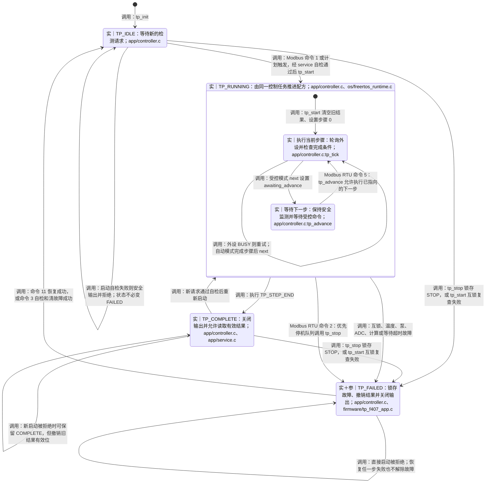
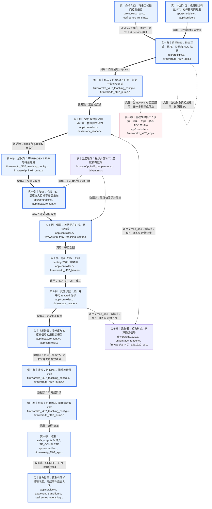
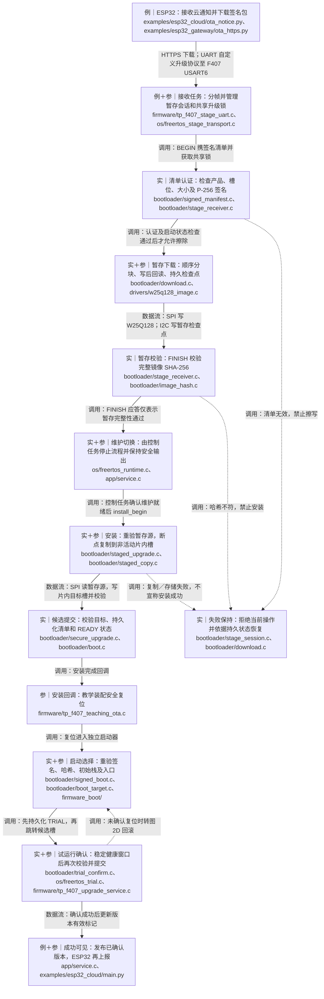
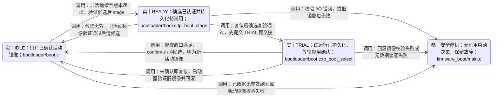
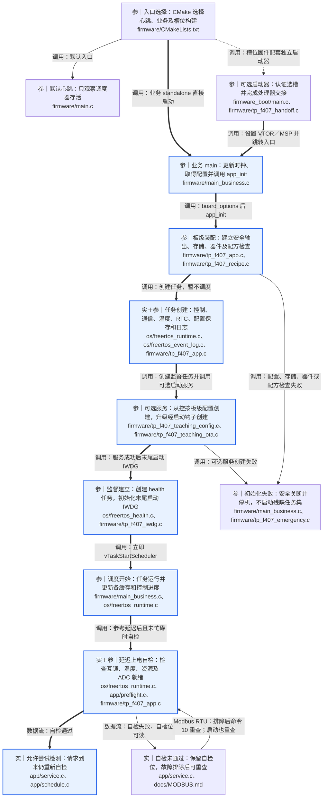
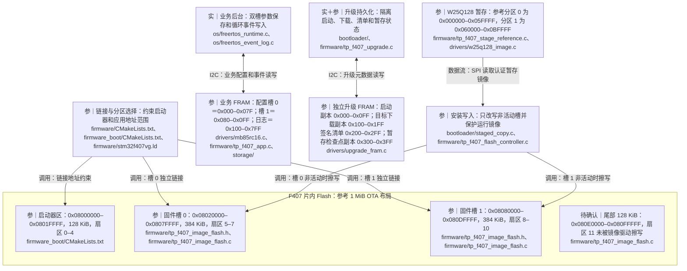
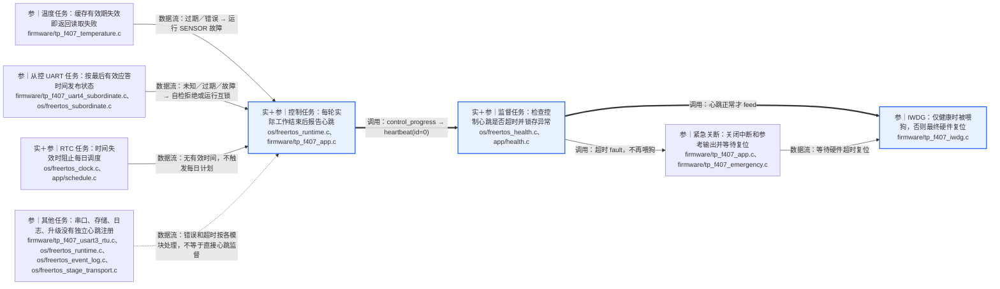

# 系统框架图：第 2、3、4 步——动态行为、存储与验证边界

本篇接续 [SYSTEM_FRAMEWORK.md](SYSTEM_FRAMEWORK.md) 的整机拓扑与主控分层。重点沿用用户此前选择的 **A：整机架构＋一次检测流程**；第二核心场景为 OTA。以下路径均相对 `水质检测/freertos/`。核对日期：2026-11-01。

标记：**实**＝自有软件逻辑已实现；**参**＝参考驱动／可选装配已实现，实机待联调；**例**＝教学配方／网络示例；**待确认**＝实际接线、部署配置或硬件效果尚无验证。软件测试状态引用 `docs/STATUS.md`，本次没有重新编译、运行测试或接板。蓝色节点／粗箭头突出 A 路径，红色节点表示故障处理；颜色不表示实机验证通过。

阅读顺序：图 2A 看控制器状态，图 2B 看一次检测的步骤，图 2C/2D 看 OTA 与回滚，图 2E 看启动，图 3A/3B 看存储和监督范围。图中“就绪”指软件允许尝试启动，不表示仪器已通过硬件验收。

## 第 2 步：动态行为

### 图 2A｜重点 A：检测控制器状态机

外层四个状态就是 `include/tp_core.h` 的 `tp_run_state`；内部“执行／等待”是 `entered`、`single_step`、`awaiting_advance` 等字段的教学归纳，不是新增的枚举状态。`TP_STEP_*` 是配方步骤类型，不能与运行状态混为一谈。

`os/freertos_runtime.c` 是控制器唯一任务所有者：完整 Modbus 帧入队后在此执行寄存器回调；周期调用 `tp_service_tick → tp_tick`。合法停止帧走独立优先队列，并清空普通队列，被丢弃的普通请求没有响应。优先级不代表硬件急停或已测得的停机时延。

启动会被保存中、维护中、自动标定／核查中、校时中等条件拒绝。启动前自检失败与运行时故障不同：前者可以保留 IDLE／COMPLETE 并清除旧读数有效性；后者进入 FAILED 并执行 `safe_outputs`。图中没有将所有拒绝都画成故障状态。

### 图 2B｜重点 A：完整教学检测配方及数据链路

粗线是重点 A 的正常路径。配方顺序逐项来自 `firmware/tp_f407_teaching_config.c:recipe[]`，由 `app/controller.c` 执行；每条链路包含 `VALVES/PUMP/READ/HEAT/HOLD/HEATER_OFF/CALCULATE/END` 实际步骤。图中部分节点归并了相邻步骤。

受控模式在每个 `next()` 后等待命令 5，包括排液结束后执行 END 前；没有收到下一步命令不应直接认为检测完成。等待期间互锁与温度检查仍继续，等待超时也会故障。周期／每日模式连续推进；每日模式需要有效 RTC，忙时计划跳过，不补跑。

采集未完成返回 BUSY 后再次调度；采样完成默认求算术平均，可选去掉一个最大和最小值。不使用延时伪装泵完成，也不使用 MCU 内部温度代替反应池温度。参考泵反馈仅证明脉冲发生计数完成，实际流量、丢步与机械反馈仍待确认。

计算模型：`A = log10(blank) - log10(reacted) - turbidity_factor × turbidity`；`C = slope × A + intercept`。输入和结果需校验。**计算成功后仍要清洗、排液；这些阶段故障会撤销结果。** 对外有效条件在 `app/service.c` 为 `state == TP_COMPLETE && result_valid`，不是“执行过计算”。采样读数、浓度和日志分别是不同的数据。

运行期间周期检查温度有效性及超温，加热关闭后也检查；每次 tick 检查互锁。F030 的资源状态过期、设备异常经互锁触发故障。图中从取样连出的故障箭头代表整个 RUNNING 的通用出口，并不只保护取样一步。

故障恢复：先排除实际故障，再通过 Modbus 命令 11 顺序执行安全输出、ADC 恢复、自检和清故障；任何失败都保持故障。也可命令 8 恢复 ADC、命令 3 清故障；命令 10 仅自检。传感器／超温故障的清除还要求当前温度有效且低于上限。F030 漏液锁存需先在从控侧按维护机制确认。成功回 IDLE，不续跑旧配方；受控模式需重启，计划模式等新的计划机会。状态观察：10 状态、11 故障、12 步骤、13 启动结果、14–15 浓度、16 有效位、18 受控等待、19 自检位、132–138 采样信号。

### 图 2C｜第二核心场景：签名暂存 OTA 链路

这是可选 staged 路径：外部 Flash 暂存，随后复制到片内执行槽。`FINISH`、安装成功、试运行确认是三个不同阶段。启动器不直接执行 W25Q128 中的镜像。另有 USART2 直接写非活动片内槽的升级入口，见 `firmware/tp_f407_upgrade_uart.c`；它不经过外部暂存，但仍须维护、安全输出、共享锁、认证及启动确认。

重连发送同一签名清单重新 BEGIN，认证后查询持久偏移续传；不能仅因响应超时假定设备未写入。部分初始元数据损坏且无有效副本时拒绝自动恢复，需可信维护。暂存会话锁覆盖接收至安装，其他升级／确认访问遵守同一把锁；断线／空闲超时 abort 释放会话资源，但不会凭空撤销已持久化的数据。

教学 OTA 的安装完成回调无论安装结果成功或失败都会安全复位；失败不等于候选已提交。通用会话本身不会复位。实物 Flash 擦写停顿与 IWDG 配合、真实签名身份、公钥保护和云端链路均待确认。

### 图 2D｜启动元数据状态：确认与回滚

两个回到 IDLE 的结果不同：确认成功把候选变为新活动槽；回滚保留旧活动槽。回滚发生在下一次启动选择，不是原地切换正在运行的代码。确认前应用崩溃、看门狗复位、断电再上电，都会使启动器看到尚未确认的 TRIAL。

确认健康条件不仅是“程序能运行”：当前 F407 装配要求控制任务有新进度、无锁存的不健康观察、处于 IDLE、非维护、自检通过，并与板级 healthy 回调取与；持续满足窗口后确认。运行／完成／故障／维护状态都不满足该应用门控。锁忙、健康失败或采样间隔过长会打断健康计时；总超时或不可恢复结果由完成回调处理，教学装配安排安全复位。

`boot.c` 单独只是回调驱动的选槽核心，安全认证由 `signed_manifest.c`、`signed_boot.c` 等组合完成。CRC 只检错；普通递增版本和 FRAM 元数据不等同于不可回退的安全计数器。真实公钥保护及防恶意元数据回滚能力待确认。Modbus 119–121 仅在确认版本有效时可用；ESP32 据此上报确认结果，MQTT QoS 0 不保证云平台收到。

### 图 2E｜重点 A：启动、任务创建和就绪条件

这是一张阶段依赖图，不强行把所有创建函数当作单一线性顺序：从控任务可在 `board_options` 阶段创建；日志任务在较早的 app_init 阶段创建；监督任务在可选升级启动钩子之前创建。所有这些都在调度器启动前，IWDG 在初始化末尾启动。任何初始化错误均走安全停机；不能继续启动已部分创建的任务。

上电自检约等待控制任务启动 2 秒，若先前已检查则不重复，忙碌时推迟。源码运行循环先 service_tick 再处理延迟上电自检，所以它不是所有计划的强制串行前置屏障；计划／手动启动各自都执行启动前自检。温度、从控更新需要时间，实际就绪延迟待确认。

## 第 3 步：运行时简化

### 图 3A｜存储布局：片内执行槽、外部暂存、参数与日志

地址均取自项目参考布局，不是对实物容量的推测。范围采用闭区间。启动器 128 KiB 是链接预留容量，不代表实际镜像大小；末尾扇区 11 未被此升级驱动使用，不能擅自命名为配置区。**配置和日志默认在外部 FRAM，并非片内 Flash 分区。** 两个固件槽是逻辑槽，F407 参考片内 Flash 为单 Bank，擦写可能阻塞取指，不能按硬件双 Bank 理解。

| 存储对象 | 参考分配与用途 | 实现／约束 |
|---|---|---|
| 片内 Flash | 128 KiB 启动器＋384 KiB 槽 0＋384 KiB 槽 1＋128 KiB 尾部 | 合计 1 MiB；槽 0、1 分别链接和签名，不能互换二进制 |
| standalone 应用 | 从 0x08000000 使用整个 1 MiB 链接范围 | 与上述 OTA 分区是互斥构建模式，不能把 standalone 镜像直接覆盖到 OTA 设备 |
| W25Q128 暂存 | 两个 384 KiB 参考分区，其他空间用途待确认 | 这里只存镜像；每分区按 4 KiB 对齐且不重叠，当前运行槽对应的外部分区只读 |
| 业务 FRAM | 两个 128 B 配置槽；1792 B 日志区 | 日志 56 条，每条 32 B；配置有版本、CRC、序号和最终提交标记 |
| 升级 FRAM | 前 1024 B 分四组，每组两个 128 B 记录区 | 启动／下载／暂存为各自双副本；清单区两个记录分别对应两个镜像槽，不能误称每镜像都有双副本 |
| 升级 FRAM 剩余 | 0x400–0x7FF 未由上述分区初始化使用 | 其他用途待确认，不能与其他设备业务区默认重叠 |
| 可选 M24C02 | 可替代配置双槽，日志仍在 FRAM | `drivers/m24c02_store.c`；与 FRAM 地址重叠需隔离总线 |

同时使用教学 OTA 时，`firmware/tp_f407_teaching_ota.c` 将业务 FRAM／RTC 放 I2C3，独立升级 FRAM 放 I2C2，与参考启动器保持一致。两颗 FRAM 的本地偏移可相同，因为它们是不同物理器件／总线；实际接线、地址和隔离待确认。

配置保存命令 4 只是异步接受，需读取寄存器 17 确认结果。启动时仅选择有效已提交记录；空白／损坏可按显式策略回退默认值，I/O 失败和已提交未知版本不当成普通默认恢复。日志 CRC 和提交标记帮助跳过损坏／未完成记录，但队列满或存储错误仍可丢日志。升级元数据双副本也不保证任何断电都自动恢复：都无效且非空白时需可信维护，不能自动格式化。

### 图 3B｜看门狗监督范围与间接故障传播

当前只注册 **1 个必需心跳：控制任务**。参考配置每 100 ms 检查，1000 ms 没有控制进展触发监督故障；这些是源码软件设定，不是实测故障响应时间。IWDG 分频及重装见驱动，实际复位时间依赖 LSI，不在此推定精确秒数。

控制任务停在忙循环时可由更高优先级监督任务发现；若 CPU／中断整体停滞，软件故障回调可能没有执行机会，只能依赖看门狗未被继续喂狗后的硬件复位。温度、从控等任务只是通过数据有效期提供间接故障传播；不能声称看门狗直接监督所有任务。RTC 无效主要影响每日计划，不应直接画成所有测量都故障。

控制任务能继续循环不代表设备一定健康：它可在 FAILED 状态继续上报进度并让监督任务喂狗。此时依靠业务故障锁存保持安全输出；试运行确认又使用更严格的健康条件。因此“看门狗存活”和“OTA 允许确认”不是同一条件。独立硬件急停未实现，独立超温切断和复位期间输出安全仍需板级落实。

## 第 4 步：重点路径、待确认项与核对证据

**重点 A 路径：** Modbus／计划触发 → 控制任务唯一所有者 → 启动前自检 → 非阻塞配方 → 光学计算 → 清洗排液 → 安全输出 → 有效结果。图 2B 粗线标注，图 2E 的蓝色启动节点和图 3B 的控制监督链是支撑路径。图 2A、2D 使用 stateDiagram-v2 表达状态，其他图用于步骤、数据流及静态布局。

| 待确认内容 | 已能从源码确认 | 仍缺少的证据 |
|---|---|---|
| 检测方法 | 教学配方和模型已实现 | 实际化学配方、标准液、标定、测量精度和标准符合性 |
| 输出安全与泵量 | 安全关断回调、定时器脉冲计数已实现 | 上电／复位电平、功率级、阀动作、流量、丢步、硬件联锁 |
| F407/F030 | UART 状态有效期、互锁和漏液锁存已有实现 | 实际输入电平、接线、轮询延迟、唤醒和 STOP 时序 |
| 调度与看门狗 | 控制单所有者、超时监督已有实现 | 目标板任务时序、资源余量、LSI 复位时间、Flash 擦写时能否满足安全策略 |
| 存储分区 | 本文地址和区域大小来自参考代码 | 实际芯片容量、烧录的构建选项、总线隔离及真实掉电恢复 |
| 安全升级 | P-256、哈希、选槽、回滚和试运行门控已实现 | 真实可信身份、公钥保护、生产初始化、物理故障与端到端部署 |
| 云端成功状态 | 示例按已确认版本上报 | ESP32 TLS 能力、实际阿里云配置和 MQTT 消息交付 |

### 与 LEARNING.md“功能与代码位置”逐项对照

| 文档功能条目 | 本篇图 | 沿文档入口核对的源码证据 |
|---|---|---|
| 启动与任务 | 2E、3B | `firmware/main_business.c` → board_options/app_init/scheduler；`firmware/tp_f407_app.c` → runtime、health、IWDG |
| 检测步骤、安全停止、自检 | 2A、2B | `app/controller.c` 的 tp_start/tp_tick/tp_stop/tp_clear_fault；`app/service.c` 的命令与 preflight；`app/preflight.c` |
| 测量、温控、标定 | 2B | `app/measurement.c`、`app/auto_calibration.c`；`drivers/adc_reader.c`、`drivers/ads1220.c`；标定不是每次检测必经步骤 |
| 周期、每日、受控 | 2A、2B | `app/schedule.c` 触发；`app/service.c` 设置 single_step；`app/controller.c` 的 awaiting_advance |
| 寄存器、上位机 | 2A、2B、2C | `protocol/`、`docs/MODBUS.md`、`tools/tp_modbus.py`、`tools/tp_gui.py`；停止优先队列在 `os/freertos_runtime.c` |
| 参数和事件保存 | 3A | `storage/config_store.c`、`storage/event_log.c`；F407 装配的 FRAM base 与日志范围；`drivers/upgrade_fram.c` 不与业务区混用 |
| 升级与从控 | 2C、2D、3B | `bootloader/`、`firmware_boot/`、`examples/esp32_cloud/`、`firmware_f030/`；主从互锁接口见 `docs/SUBORDINATE.md` |
| 两种 RTOS 采集示例 | 前篇图 2 | `examples/posix_slice/`、`examples/posix_control/`、`zephyr_slice/` 是模拟／局部链路，不作为本文实机运行证据 |

核对顺序：先承接指定六份文档和 LEARNING 映射，再读取映射指向的自有源码；检查状态枚举与条件分支、步骤数组与处理分支、链接地址与分区常量、FRAM 区域偏移与装配选择，最后用 STATUS 和各固件 README 标注验证边界。本次没有读取 build*、tests/、third_party/、.git、.vscode 的内容，没有运行这些目录中的产物。图中精确地址是参考工程定义，不是对当前硬件烧录状态的断言。

交付检查：本篇包含 7 个 Mermaid 代码块（其中 2 个状态图），76 个显式源码／文档路径均存在；片内参考分区合计 1024 KiB，外部暂存槽边界与参考常量相符。已做代码块及流程节点引用的结构检查；本机未发现 Mermaid 解析器，未进行正式解析／图形渲染验证。没有以路径存在性代替上述调用与条件核对，也没有把文档中的既有主机测试报告写成本次测试结果。
